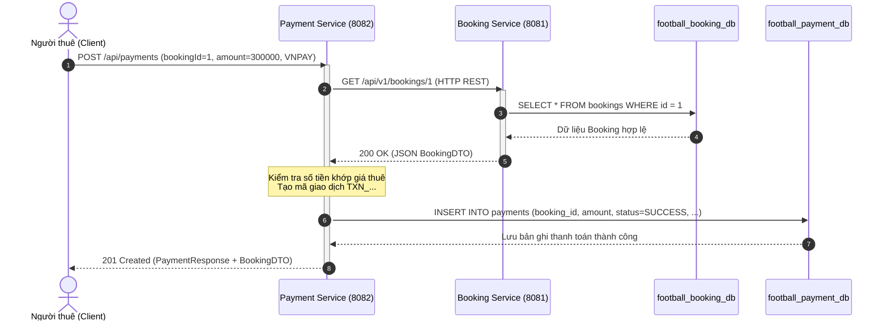
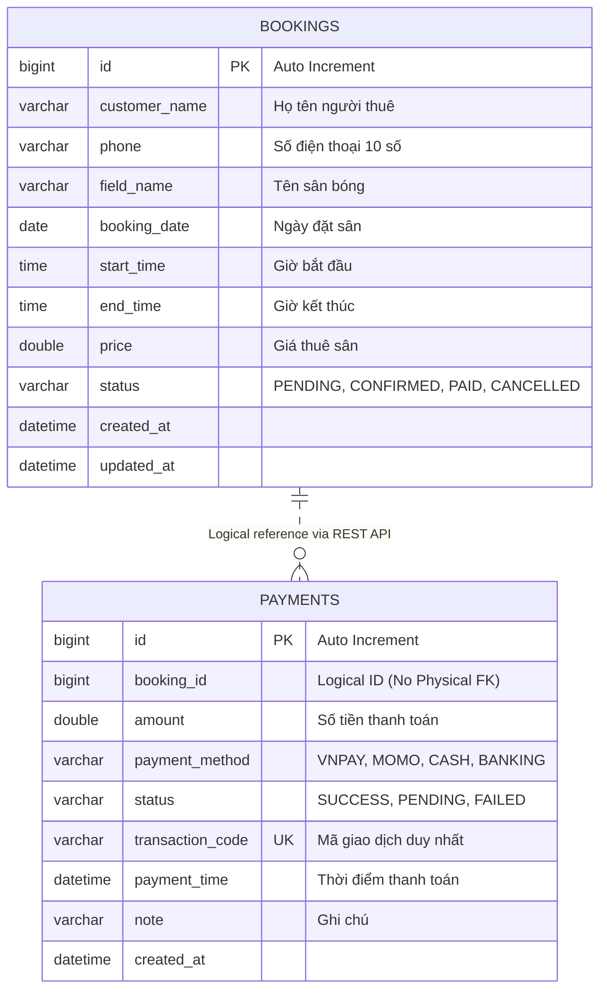

# THIẾT KẾ DỮ LIỆU VÀ DỊCH VỤ (DATA AND SERVICE DESIGN)
## Đề tài: Hệ thống Quản lý cho thuê sân bóng đá (Football Pitch Rental Management)
**Kiến trúc:** Microservices Architecture (Database-per-Service)  
**Công nghệ:** Spring Boot, Spring Data JPA, MySQL 8.x, REST API  

---

## 1. Danh sách Service trong hệ thống

Hệ thống được thiết kế theo kiến trúc Microservices gồm các dịch vụ độc lập:
1. **Booking Service (Port 8081):** Quản lý toàn bộ thông tin lịch đặt sân, khung giờ, bảng giá và trạng thái duyệt sân.
2. **Payment Service (Port 8082):** Quản lý các giao dịch thanh toán (tiền cọc, tiền thuê), tích hợp cổng thanh toán (VNPAY, MoMo, Chuyển khoản ngân hàng).
3. **Notification Service (Port 8083 - Node.js):** Dịch vụ gửi tin nhắn SMS, Email xác nhận lịch đặt sân cho khách hàng.
4. **Customer Service (Mở rộng):** Quản lý hồ sơ tài khoản người thuê và chủ sân.

---

## 2. Database của từng Service (Database-per-Service)

Tuân thủ nghiêm ngặt nguyên tắc **Database-per-Service**, mỗi dịch vụ sở hữu một CSDL quan hệ riêng biệt:

| Service | Database sở hữu | Hệ quản trị CSDL | Cổng kết nối |
| :--- | :--- | :--- | :--- |
| **Booking Service** | `football_booking_db` | MySQL 8.x | 3306 |
| **Payment Service** | `football_payment_db` | MySQL 8.x | 3306 |
| **Notification Service** | Bộ nhớ đệm / Message Queue | RAM / RabbitMQ | 5672 |

---

## 3. Thiết kế Entity của từng Service

### 3.1. Entity của Booking Service (`football_booking_db.bookings`)
* `id` (BIGINT, Primary Key, Auto Increment): Mã định danh duy nhất của lượt đặt sân.
* `customer_name` (VARCHAR(100), NOT NULL): Họ tên khách hàng người thuê.
* `phone` (VARCHAR(15), NOT NULL): Số điện thoại liên hệ (10 chữ số).
* `field_name` (VARCHAR(100), NOT NULL): Tên sân (San 7 nguoi so 1, San 11 VIP,...).
* `booking_date` (DATE, NOT NULL): Ngày thuê sân (yyyy-MM-dd).
* `start_time` (TIME, NOT NULL): Giờ bắt đầu thuê.
* `end_time` (TIME, NOT NULL): Giờ kết thúc thuê.
* `price` (DOUBLE, NOT NULL, Positive): Giá thuê sân tính bằng VNĐ.
* `status` (VARCHAR(20), NOT NULL): Trạng thái (`PENDING`, `CONFIRMED`, `PAID`, `CANCELLED`).
* `created_at`, `updated_at` (DATETIME): Thời điểm tạo và cập nhật bản ghi.

### 3.2. Entity của Payment Service (`football_payment_db.payments`)
* `id` (BIGINT, Primary Key, Auto Increment): Mã giao dịch thanh toán.
* `booking_id` (BIGINT, NOT NULL): **Logical ID** tham chiếu sang Booking Service qua REST API (**không tạo Foreign Key vật lý**).
* `amount` (DOUBLE, NOT NULL, Positive): Số tiền thực thanh toán (VNĐ).
* `payment_method` (VARCHAR(20), NOT NULL): `VNPAY`, `MOMO`, `CASH`, `BANKING`.
* `status` (VARCHAR(20), NOT NULL): `SUCCESS`, `PENDING`, `FAILED`.
* `transaction_code` (VARCHAR(50), NOT NULL, UNIQUE): Mã tham chiếu giao dịch hệ thống.
* `payment_time` (DATETIME, NOT NULL): Thời gian thực hiện giao dịch.
* `note` (VARCHAR(255)): Ghi chú thanh toán.

---

## 4. Ma trận quyền sở hữu dữ liệu (Data Ownership Matrix)

| Dữ liệu nghiệp vụ | Service sở hữu | Database lưu trữ | Cơ chế truy cập từ Service khác |
| :--- | :--- | :--- | :--- |
| Thông tin lịch đặt sân, khung giờ, giá thuê | **Booking Service** | `football_booking_db` | **Bắt buộc gọi qua REST API:** `GET /api/v1/bookings/{id}` |
| Hóa đơn, giao dịch thanh toán, cổng thanh toán | **Payment Service** | `football_payment_db` | **Bắt buộc gọi qua REST API:** `GET /api/payments/{id}` |

> **Nguyên tắc kiến trúc:** Tuyệt đối không cho phép `Payment Service` kết nối trực tiếp vào `football_booking_db` (và ngược lại). Quyền truy cập trực tiếp chỉ thuộc về Service sở hữu.

---

## 5. Danh mục API của từng Service

### 5.1. Booking Service (Port 8081)
* `GET /api/v1/bookings`: Truy vấn danh sách kết hợp (Search, Filter, Sort, Pagination).
* `GET /api/v1/bookings/{id}`: Lấy chi tiết lịch đặt sân theo ID.
* `POST /api/v1/bookings`: Tạo mới lịch đặt sân (`201 Created`).
* `PUT /api/v1/bookings/{id}`: Cập nhật toàn bộ thông tin lịch đặt sân.
* `PATCH /api/v1/bookings/{id}`: Cập nhật một phần (VD: đổi trạng thái, đổi giờ).
* `DELETE /api/v1/bookings/{id}`: Xóa lịch đặt sân (`204 No Content`).
* `GET /api/v1/bookings/statistics`: Thống kê số lượng đơn và doanh thu.
* `GET /api/v1/bookings/{id}/payments`: Nested Resource lấy lịch sử thanh toán của đơn.

### 5.2. Payment Service (Port 8082)
* `GET /api/payments`: Lấy danh sách toàn bộ giao dịch thanh toán.
* `GET /api/payments/{id}`: Lấy chi tiết giao dịch thanh toán theo ID.
* `POST /api/payments`: Tiếp nhận thanh toán, gọi xác minh với Booking Service, lưu DB.
* `POST /api/payments/fallback`: Cơ chế dự phòng khi Booking Service tạm gián đoạn.

---

## 6. Service-to-Service Communication

```
Client (Người thuê)
   │
   │ 1. POST /api/payments {"bookingId": 1, "amount": 300000.0, "paymentMethod": "VNPAY"}
   ▼
Payment Service (Port 8082)
   │
   │ 2. HTTP GET /api/v1/bookings/1 (Synchronous RestClient Call)
   ▼
Booking Service (Port 8081)
   │
   │ 3. SELECT * FROM bookings WHERE id = 1;
   ▼
football_booking_db (MySQL)
   │
   │ 4. Trả về dữ liệu bản ghi Booking
   ▼
Booking Service (Port 8081)
   │
   │ 5. Phản hồi JSON Booking {id: 1, customerName: "Nguyen Van An", price: 300000.0}
   ▼
Payment Service (Port 8082)
   │
   │ 6. INSERT INTO payments (...) VALUES (1, 300000.0, 'VNPAY', 'SUCCESS', ...);
   ▼
football_payment_db (MySQL)
   │
   │ 7. Phản hồi HTTP 201 Created (Kèm thông tin Payment và Booking)
   ▼
Client (Người thuê)
```

---

## 7. Sequence Diagram (Sơ đồ tuần tự nghiệp vụ thanh toán)



---

## 8. Database Diagram (Sơ đồ CSDL Microservices)



---

## 9. Nghiệp vụ End-to-End: Thuê sân và Thanh toán

1. **Khách hàng đặt sân:** Gửi `POST /api/v1/bookings` $\rightarrow$ lưu bản ghi vào `football_booking_db` với trạng thái `PENDING`.
2. **Chủ sân xác nhận:** Gọi `PATCH /api/v1/bookings/{id}` $\rightarrow$ cập nhật trạng thái thành `CONFIRMED`.
3. **Khách hàng thanh toán:** Gửi `POST /api/payments` $\rightarrow$ `Payment Service` gọi REST sang `Booking Service` kiểm tra lịch đặt $\rightarrow$ lưu giao dịch `SUCCESS` vào `football_payment_db`.
4. **Đối soát & Báo cáo:** Chủ sân gọi `GET /api/v1/bookings/statistics` $\rightarrow$ hệ thống tính tổng doanh thu từ các đơn `PAID`.

---

## 10. Các tình huống lỗi phân tán và Cách xử lý

1. **Lịch đặt sân không tồn tại trong DB:**
   * `Payment Service` gọi sang `Booking Service` nhận về `404 Not Found`.
   * `Payment Service` hủy quy trình thanh toán, không lưu dữ liệu rác vào `football_payment_db`, trả về HTTP `404 Not Found` kèm thông điệp: *"Không tìm thấy lịch đặt sân để thanh toán"*.
2. **Booking Service bị sập / Tắt kết nối:**
   * `Booking Client` ném ra ngoại lệ `ResourceAccessException` (Connection Refused).
   * Bắt lỗi tập trung tại `GlobalExceptionHandler`, trả về mã **`503 Service Unavailable`** rõ ràng, không để crash ứng dụng.
3. **Mạng chậm / Treo phản hồi (Timeout):**
   * Cấu hình `readTimeout = 3000ms`. Nếu `Booking Service` không trả lời trong 3 giây $\rightarrow$ tự động ngắt và trả về **`504 Gateway Timeout`**.
4. **Cơ chế Fallback (Xử lý khi khẩn cấp):**
   * Cung cấp API `POST /api/payments/fallback` cho phép ghi nhận thanh toán ở trạng thái `PENDING` vào MySQL để nhân viên đối soát thủ công sau khi dịch vụ hồi phục.
