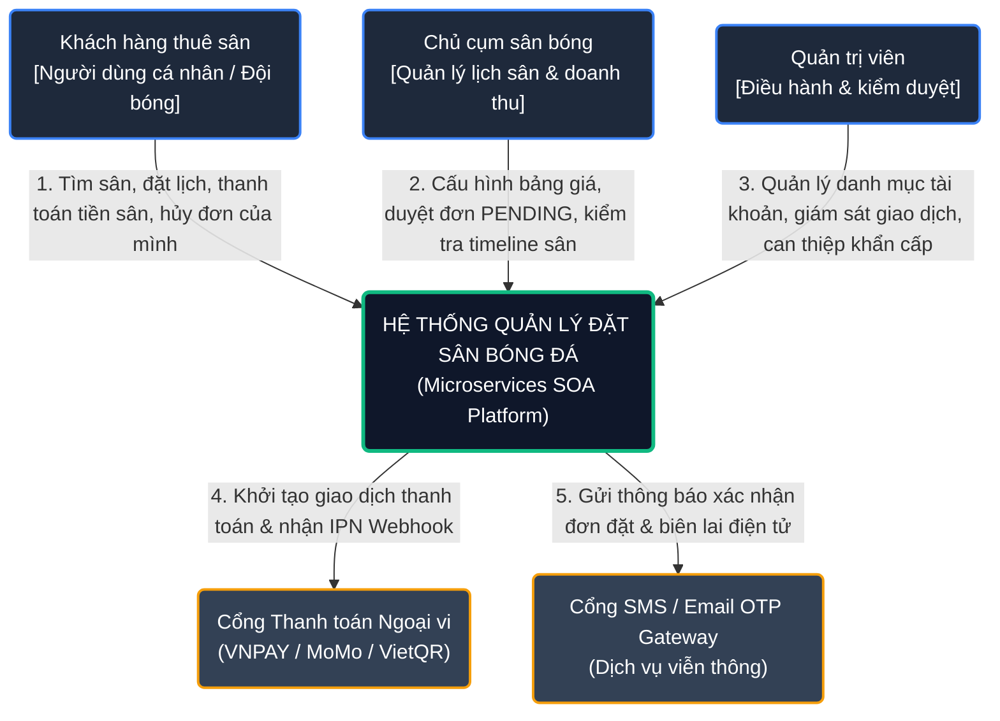
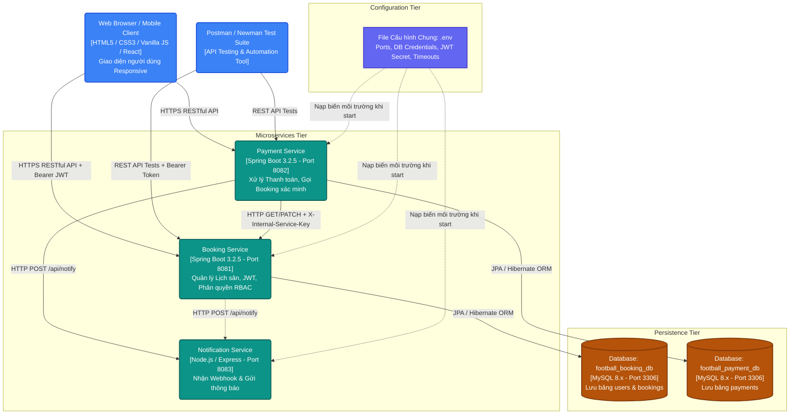
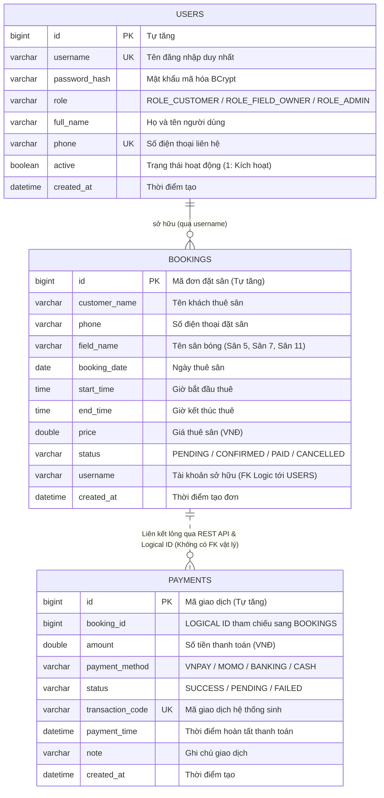
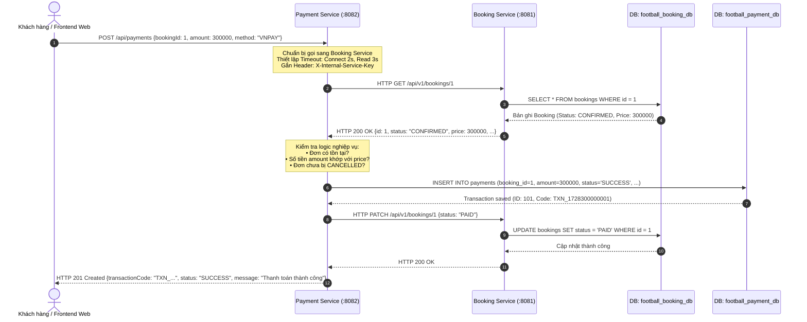
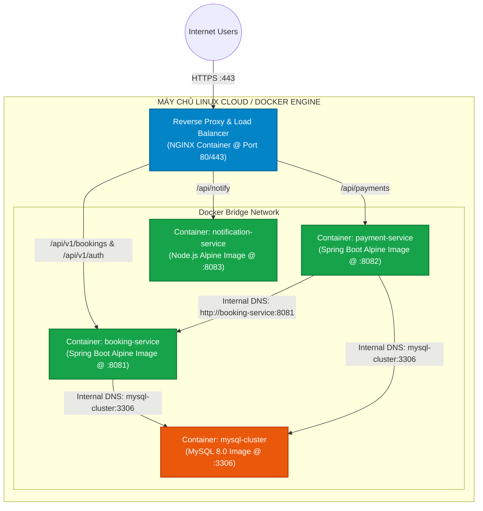

# TÀI LIỆU THIẾT KẾ KIẾN TRÚC TỔNG THỂ HỆ THỐNG
## DỰ ÁN: NỀN TẢNG ĐẶT SÂN BÓNG ĐÁ TRỰC TUYẾN (FOOTBALL BOOKING SYSTEM)
**Kiến trúc:** Hướng dịch vụ phân tán (SOA / Microservices Architecture)  
**Tài liệu:** Software Architecture Document (SAD)  
**Phiên bản:** 2.0  
**Ngày cập nhật:** 26/10/2026  

---

# I. TỔNG QUAN KIẾN TRÚC HỆ THỐNG (ARCHITECTURAL OVERVIEW)

## 1. Mục tiêu & Triết lý thiết kế (Design Principles)
Hệ thống quản lý cho thuê sân bóng đá được thiết kế nhằm đáp ứng nhu cầu kết nối đa chiều giữa **Khách hàng thuê sân**, **Chủ cụm sân bóng** và **Ban quản trị hệ thống**. Hệ thống tuân thủ các nguyên lý cốt lõi của Kiến trúc hướng dịch vụ (SOA) và Microservices:

1. **Ranh giới nghiệp vụ độc lập (Bounded Context - DDD):** Mỗi microservice phụ trách duy nhất một miền nghiệp vụ nghiệp vụ khép kín (Quản lý lịch đặt sân, Xử lý giao dịch thanh toán, Phát đi thông báo).
2. **Kiến trúc dữ liệu phân tán (Database-per-Service):** Mỗi dịch vụ sở hữu và toàn quyền quản lý CSDL vật lý riêng biệt (`football_booking_db` và `football_payment_db`). Tuyệt đối không truy cập trực tiếp CSDL của dịch vụ khác.
3. **Liên kết lỏng lẻo (Loose Coupling):** Các dịch vụ chỉ giao tiếp thông qua hợp đồng giao diện kỹ thuật chuẩn hóa (RESTful API JSON) và khóa xác thực nội bộ. Sự thay đổi cấu trúc bảng hay logic nội bộ của một service không làm gián đoạn các service còn lại.
4. **Bảo mật đa tầng theo chiều sâu (Defense-in-Depth):** Bảo vệ toàn diện từ tầng mạng, cổng API, phân quyền vai trò (RBAC), kiểm tra quyền sở hữu tài nguyên (Resource Ownership) đến mã hóa mật khẩu một chiều (BCrypt).
5. **Cấu hình tập trung (Single Source of Truth):** Quản lý toàn bộ thông số môi trường (Port, MySQL credentials, JWT Secret, Timeouts) qua file duy nhất [.env](file:///c:/Users/abinh/Downloads/football-booking-service/.env) tại thư mục gốc.

---

## 2. Sơ đồ Kiến trúc Tổng thể Đa tầng (High-Level Multi-Tier Architecture)

```
┌────────────────────────────────────────────────────────────────────────────────────────────────────────────────────────┐
│                                     SƠ ĐỒ KIẾN TRÚC TỔNG THỂ DỰ ÁN (OVERALL SYSTEM ARCHITECTURE)                      │
└────────────────────────────────────────────────────────────────────────────────────────────────────────────────────────┘

 [ 1. TẦNG KHÁCH HÀNG (CLIENT TIER) ]
   ├── Khách hàng thuê sân (Mobile Browser / Desktop Web App)
   ├── Chủ sân bóng (Owner Dashboard / Calendar Matrix Timeline)
   ├── Quản trị viên hệ thống (Admin Portal / Analytics Dashboard)
   └── Kỹ sư kiểm thử API tự động (Postman Collection / Newman CLI / Swagger UI)
                           │
                           ▼ HTTPS / RESTful API (JSON Payload)
 ─────────────────────────────────────────────────────────────────────────────────────────────────────────────────────────
 [ 2. TẦNG AN NINH & ĐIỀU HƯỚNG CỔNG (SECURITY & API GATEWAY BOUNDARY) ]
   ├── Bộ lọc kiểm tra Bearer JWT Token (`JwtAuthenticationFilter`)
   ├── Trích xuất Claims: `sub` (Username), `role` (CUSTOMER, FIELD_OWNER, ADMIN)
   ├── Phân định ngữ cảnh bảo mật (`SecurityContextHolder`)
   ├── Xử lý mã lỗi chuẩn hóa: 401 Unauthorized (Chưa xác thực) vs 403 Forbidden (Sai quyền/Lệch chủ sở hữu)
   └── Khóa xác thực liên dịch vụ máy-với-máy (`X-Internal-Service-Key`)
                           │
                           ├───────────────────────────────────────────┬───────────────────────────────────────────┐
                           ▼                                           ▼                                           ▼
 ─────────────────────────────────────────────────────────────────────────────────────────────────────────────────────────
 [ 3. TẦNG CÁC VI DỊCH VỤ NGHIỆP VỤ (MICROSERVICES APPLICATION TIER) ]
  ┌──────────────────────────────────────────────┐ ┌──────────────────────────────────────────────┐ ┌────────────────────┐
  │         FOOTBALL BOOKING SERVICE             │ │           FOOTBALL PAYMENT SERVICE           │ │NOTIFICATION SERVICE│
  │     (Spring Boot 3.2.5 - Port 8081)          │ │       (Spring Boot 3.2.5 - Port 8082)        │ │(Node.js - Port8083)│
  │                                              │ │                                              │ │                    │
  │ • Quản lý Lịch đặt sân (CRUD Bookings)       │ │ • Tiếp nhận & xử lý giao dịch thanh toán     │ │ • Tiếp nhận sự kiện│
  │ • Tìm kiếm, lọc sân, kiểm tra xung đột giờ   │ │ • Tích hợp VNPAY, MoMo, VietQR, Tiền mặt     │ │   đặt sân mới      │
  │ • Xác thực JWT, đăng ký & băm BCrypt mật khẩu│ │ • RestClient gọi sang Booking Service (8081) │ │ • Cảnh báo duyệt   │
  │ • Kiểm tra Resource Ownership (Chống BOLA)   │ │ • Quản lý mã giao dịch duy nhất (TXN_...)    │ │   hủy, thanh toán  │
  │ • Thống kê doanh thu sân bóng theo thời gian │ │ • Cơ chế Timeout (2s/3s) & Fallback Controller│ │ • Gửi Email / SMS  │
  └──────────────────────┬───────────────────────┘ └──────────────────────┬───────────────────────┘ └─────────▲──────────┘
                         │                                                │                                   │
                         │                                                │   HTTP POST /api/notify           │
                         │                                                └───────────────────────────────────┘
                         │
                         │                 HTTP Synchronous GET /api/v1/bookings/{id}
                         │         ◄───────────────────────────────────────────────────────┐
                         │                 (Header: X-Internal-Service-Key, Timeout 2s/3s) │
                         │                                                                 │
 ────────────────────────┼─────────────────────────────────────────────────────────────────┼──────────────────────
 [ 4. TẦNG CƠ SỞ DỮ LIỆU BỀN VỮNG (PERSISTENCE DATA TIER - DATABASE-PER-SERVICE) ]         │
                         │                                                                 │
                         ▼ Spring Data JPA / Hibernate ORM                                 ▼ Spring Data JPA / Hibernate
  ┌──────────────────────────────────────────────┐                 ┌──────────────────────────────────────────────┐
  │             football_booking_db              │                 │             football_payment_db              │
  │            (MySQL 8.x @ Port 3306)           │                 │            (MySQL 8.x @ Port 3306)           │
  │                                              │                 │                                              │
  │ • Bảng `users`: id, username, password_hash, │                 │ • Bảng `payments`: id, booking_id, amount,   │
  │   role, full_name, phone, active, created_at │                 │   payment_method, status, transaction_code,  │
  │ • Bảng `bookings`: id, customer_name, phone, │                 │   payment_time, note, created_at             │
  │   field_name, booking_date, start_time,      │                 │   *(booking_id là LOGICAL ID, KHÔNG có       │
  │   end_time, price, status, username          │                 │    khóa ngoại vật lý sang bảng bookings)*    │
  └──────────────────────────────────────────────┘                 └──────────────────────────────────────────────┘
                         ▲                                                                 ▲
                         └────────────────────────────────┬────────────────────────────────┘
                                                          │ Đọc biến môi trường khi khởi động
 ─────────────────────────────────────────────────────────┼───────────────────────────────────────────────────────
 [ 5. TẦNG QUẢN TRỊ CẤU HÌNH HỆ THỐNG (CENTRALIZED CONFIGURATION INFRASTRUCTURE) ]
   ┌─────────────────────────────────────────────────────────────────────────────────────────────────────────────┐
   │                                     FILE CẤU HÌNH TỔNG: `.env` (Single Source of Truth)                     │
   │  • Server Ports: BOOKING_SERVICE_PORT=8081, PAYMENT_SERVICE_PORT=8082, NOTIFICATION_SERVICE_PORT=8083     │
   │  • MySQL Settings: MYSQL_HOST=localhost, MYSQL_PORT=3306, MYSQL_USER=root, MYSQL_PASSWORD=...             │
   │  • Databases: MYSQL_BOOKING_DB=football_booking_db, MYSQL_PAYMENT_DB=football_payment_db                   │
   │  • Security: JWT_SECRET=..., JWT_EXPIRATION_MS=86400000, INTERNAL_SERVICE_KEY=FootballBookingSecretKey... │
   │  • Inter-service: PAYMENT_BOOKING_SERVICE_URL=http://localhost:8081, CONNECT_TIMEOUT=2000, READ_TIMEOUT=3000│
   └─────────────────────────────────────────────────────────────────────────────────────────────────────────────┘
```

---

# II. MÔ HÌNH HÓA KIẾN TRÚC THEO CHUẨN C4 (C4 MODEL)

Kiến trúc phần mềm được phân rã chi tiết qua 4 cấp độ từ tổng thể ngữ cảnh (Context) đến cấu trúc mã nguồn (Component):

## 1. C4 Level 1: Sơ đồ Ngữ cảnh Hệ thống (System Context Diagram)

Mô tả sự tương tác giữa các tác nhân (Actors), hệ thống đặt sân bóng và các hệ thống ngân hàng / cổng thanh toán bên thứ ba:



---

## 2. C4 Level 2: Sơ đồ Thùng chứa (Container Diagram)

Mô tả các ứng dụng, tiến trình phần mềm độc lập và các kho lưu trữ dữ liệu tạo nên giải pháp hoàn chỉnh:



---

## 3. C4 Level 3: Sơ đồ Thành phần bên trong từng Microservice (Component Diagram)

### 3.1. Cấu trúc Thành phần bên trong `football-booking-service` (Port 8081)

Booking Service được xây dựng theo kiến trúc phân lớp chuẩn mực (**Layered Clean Architecture**):

```
┌────────────────────────────────────────────────────────────────────────────────────────────────────────┐
│                               BOOKING SERVICE COMPONENT ARCHITECTURE (PORT 8081)                       │
├────────────────────────────────────────────────────────────────────────────────────────────────────────┤
│ 1. TẦNG SECURITY FILTER CHAIN                                                                          │
│    ├── JwtAuthenticationFilter: Chặn mọi request, trích xuất "Bearer <JWT>", giải mã claims.           │
│    ├── JwtTokenProvider: Tạo token khi login thành công, kiểm tra tính hợp lệ & chữ ký HS256.          │
│    ├── CustomUserDetailsService: Nạp thông tin tài khoản từ UserRepository lên Spring Security Context.│
│    ├── JwtAuthenticationEntryPoint: Trả về HTTP 401 khi không có token hoặc token sai/hết hạn.         │
│    └── CustomAccessDeniedHandler: Trả về HTTP 403 khi người dùng không đủ quyền hạn vai trò.           │
├────────────────────────────────────────────────────────────────────────────────────────────────────────┤
│ 2. TẦNG ĐIỀU HƯỚNG & TIẾP NHẬN YÊU CẦU (CONTROLLER LAYER)                                              │
│    ├── AuthController (/api/v1/auth):                                                                  │
│    │     • POST /register: Đăng ký tài khoản khách hàng mới.                                           │
│    │     • POST /login: Xác thực mật khẩu BCrypt, cấp phát JWT Token.                                  │
│    │     • GET /me: Lấy thông tin tài khoản đang đăng nhập.                                            │
│    └── BookingController (/api/v1/bookings):                                                           │
│          • GET /: Lọc, tìm kiếm, phân trang danh sách sân (Public).                                     │
│          • GET /{id}: Xem chi tiết đơn (Kiểm tra quyền sở hữu Resource Ownership).                     │
│          • POST /: Đặt lịch sân mới (Gán username từ JWT, kiểm tra trùng giờ).                         │
│          • PUT /{id} & PATCH /{id}: Cập nhật trạng thái (Chủ sân / Admin).                             │
│          • DELETE /{id}: Hủy đơn (Chủ đơn chưa thanh toán hoặc Admin).                                 │
│          • GET /statistics: Thống kê doanh thu (Chỉ FIELD_OWNER & ADMIN).                              │
├────────────────────────────────────────────────────────────────────────────────────────────────────────┤
│ 3. TẦNG NGHIỆP VỤ LÕI (SERVICE LAYER)                                                                  │
│    ├── AuthService: Xử lý logic băm mật khẩu BCrypt (cost 10), xác thực đăng nhập, khởi tạo User mẫu.  │
│    └── BookingService:                                                                                 │
│          • Logic kiểm tra xung đột thời gian thuê sân (Time overlap algorithm).                        │
│          • Cơ chế bảo vệ quyền sở hữu dữ liệu (verifyBookingOwnership, verifyBookingCancellation).     │
│          • Logic tính toán tổng doanh thu thực thu từ các đơn trạng thái PAID.                         │
│          • Quản lý giao dịch nguyên tử với annotation @Transactional.                                  │
├────────────────────────────────────────────────────────────────────────────────────────────────────────┤
│ 4. TẦNG TRUY XUẤT DỮ LIỆU & THỰC THỂ (REPOSITORY & DOMAIN ENTITY LAYER)                                │
│    ├── UserRepository: Kế thừa JpaRepository<User, Long>, tìm kiếm theo username, phone.              │
│    ├── BookingRepository: Kế thừa JpaRepository<Booking, Long>, lọc theo ngày, sân, trạng thái.       │
│    ├── Entity User: id, username, password_hash, role, full_name, phone, active.                      │
│    └── Entity Booking: id, customer_name, phone, field_name, booking_date, times, price, status, user. │
├────────────────────────────────────────────────────────────────────────────────────────────────────────┤
│ 5. TẦNG XỬ LÝ NGOẠI LỆ TẬP TRUNG (GLOBAL EXCEPTION HANDLER)                                            │
│    └── GlobalExceptionHandler (@RestControllerAdvice):                                                 │
│          • Bắt BadCredentialsException ──► Trả về HTTP 401 Unauthorized.                               │
│          • Bắt AccessDeniedException ──► Trả về HTTP 403 Forbidden.                                   │
│          • Bắt MethodArgumentNotValidException ──► Trả về HTTP 400 Bad Request kèm chi tiết lỗi field. │
│          • Bắt NoSuchElementException / EntityNotFoundException ──► Trả về HTTP 404 Not Found.        │
└────────────────────────────────────────────────────────────────────────────────────────────────────────┘
```

---

### 3.2. Cấu trúc Thành phần bên trong `payment-service` (Port 8082)

Payment Service được tối ưu hóa cho bài toán giao tiếp liên dịch vụ và ghi nhận thanh toán:

```
┌────────────────────────────────────────────────────────────────────────────────────────────────────────┐
│                               PAYMENT SERVICE COMPONENT ARCHITECTURE (PORT 8082)                       │
├────────────────────────────────────────────────────────────────────────────────────────────────────────┤
│ 1. TẦNG CONTROLLER: PaymentController (/api/payments)                                                  │
│    ├── POST /api/payments: Tiếp nhận thanh toán {bookingId, amount, paymentMethod}.                    │
│    ├── GET /api/payments: Liệt kê toàn bộ giao dịch thanh toán.                                        │
│    └── GET /api/payments/{id}: Tra cứu chi tiết giao dịch theo mã ID.                                  │
├────────────────────────────────────────────────────────────────────────────────────────────────────────┤
│ 2. TẦNG SERVICE: PaymentService                                                                        │
│    ├── Sinh mã giao dịch duy nhất: "TXN_" + System.currentTimeMillis().                                │
│    ├── Quản lý trạng thái giao dịch: SUCCESS / PENDING / FAILED.                                       │
│    └── Quản lý giao dịch phân tán cấp ứng dụng.                                                        │
├────────────────────────────────────────────────────────────────────────────────────────────────────────┤
│ 3. TẦNG GIAO TIẾP LIÊN DỊCH VỤ (CLIENT TIER): BookingClient                                            │
│    ├── Sử dụng RestClient hiện đại của Spring Framework 6.                                             │
│    ├── Cấu hình Timeout nghiêm ngặt: Connect Timeout = 2000ms, Read Timeout = 3000ms.                  │
│    ├── Tự động gắn Header bảo mật máy-với-máy: `X-Internal-Service-Key`.                               │
│    ├── Phương thức getBookingById(Long id): Gọi GET /api/v1/bookings/{id} để xác minh số tiền & đơn.   │
│    ├── Phương thức updateBookingStatus(Long id, String status): Gọi PATCH cập nhật đơn sang PAID.      │
│    └── Xử lý ngoại lệ ResourceAccessException / HttpServerErrorException khi Booking Service gặp sự cố│
├────────────────────────────────────────────────────────────────────────────────────────────────────────┤
│ 4. TẦNG DỮ LIỆU BỀN VỮNG: PaymentRepository & Entity Payment                                           │
│    ├── Entity Payment: id, booking_id, amount, payment_method, status, transaction_code, payment_time. │
│    └── PaymentRepository: Kế thừa JpaRepository kết nối tới MySQL `football_payment_db`.               │
└────────────────────────────────────────────────────────────────────────────────────────────────────────┘
```

---

# III. THIẾT KẾ DỮ LIỆU PHÂN TÁN (DATABASE-PER-SERVICE DESIGN)

Hệ thống tuân thủ nghiêm ngặt nguyên tắc thiết kế **Database-per-Service** của kiến trúc Microservices:

## 1. Lược đồ Cơ sở Dữ liệu & Mối quan hệ Logic (Logical ERD)



## 2. Nguyên tắc Bất khả xâm phạm trong Quản lý Dữ liệu

| Tiêu chí | Cơ sở dữ liệu: `football_booking_db` | Cơ sở dữ liệu: `football_payment_db` |
| :--- | :--- | :--- |
| **Dịch vụ sở hữu duy nhất** | `Booking Service` (Port 8081) | `Payment Service` (Port 8082) |
| **Quyền truy cập trực tiếp (Direct DB Access)** | **Chỉ cho phép** Booking Service kết nối. | **Chỉ cho phép** Payment Service kết nối. |
| **Chính sách đối với Foreign Key vật lý** | Không có bất kỳ Foreign Key nào liên kết sang bảng `payments`. | Bảng `payments` chứa cột `booking_id` làm **Logical Reference ID**, không có ràng buộc Foreign Key sang bảng `bookings`. |
| **Cách Payment Service đọc thông tin đơn** | Không được phép chạy câu lệnh `SELECT ... FROM football_booking_db.bookings`. Bắt buộc gửi HTTP GET qua REST API `http://localhost:8081/api/v1/bookings/{id}`. | Payment Service tự quản lý dữ liệu bảng `payments` độc lập. |
| **Lợi ích kiến trúc mang lại** | • Khi đổi cấu trúc bảng `bookings`, `Payment Service` hoàn toàn không bị ảnh hưởng (Zero Coupling).<br>• Dễ dàng chuyển dịch từng CSDL sang các Server/Cluster riêng biệt khi mở rộng quy mô. |

---

# IV. KIẾN TRÚC GIAO TIẾP VÀ KHẢ NĂNG CHỊU LỖI (INTER-SERVICE COMMUNICATION & RESILIENCE)

## 1. Giao tiếp Đồng bộ (Synchronous Inter-Service Flow)

Quy trình giao tiếp giữa Payment Service và Booking Service khi khách hàng thanh toán tiền sân:



---

## 2. Chiến lược Chịu lỗi & Phục hồi khi có Sự cố Phân tán (Fault Tolerance & Resilience)

1. **Kiểm soát Timeout (Timeout Management):**
   * Trong hệ thống phân tán, nếu dịch vụ đích phản hồi chậm mà không có Timeout, các luồng (Thread) của dịch vụ gọi sẽ bị treo (Thread Starvation), kéo theo sự sụp đổ dây chuyền (Cascading Failure).
   * Hệ thống cấu hình cứng hai mốc Timeout trên `RestClient`:
     * `connectTimeout`: **2000 ms** (Tối đa 2 giây để bắt tay TCP).
     * `readTimeout`: **3000 ms** (Tối đa 3 giây để nhận gói tin phản hồi).
2. **Cơ chế Dự phòng (Fallback Mechanism):**
   * Khi Booking Service tạm thời mất kết nối (Down hoặc khởi động lại), `Payment Service` bắt ngoại lệ `ResourceAccessException` và chuyển sang luồng xử lý dự phòng:
   * Trả về thông báo HTTP `503 Service Unavailable`: *"Dịch vụ quản lý đơn đặt sân tạm thời gián đoạn. Giao dịch thanh toán được lưu ở trạng thái PENDING và sẽ được đối soát tự động khi dịch vụ hoạt động trở lại."*
   * Không để người dùng bị crash trang trắng hoặc mất tiền oan.

---

# V. KIẾN TRÚC AN NINH BẢO MẬT ĐA TẦNG (MULTI-LAYERED SECURITY ARCHITECTURE)

Hệ thống triển khai mô hình an ninh mạng **Defense-in-Depth** gồm 5 lớp bảo vệ liên hoàn:

```
┌────────────────────────────────────────────────────────────────────────────────────────────────────────┐
│                                 5 LỚP BẢO VỆ AN NINH HỆ THỐNG (DEFENSE-IN-DEPTH)                       │
├─────────────────────┬──────────────────────────────────────────────────────────────────────────────────┤
│ LỚP 1: TẦNG BIÊN    │ • Phân tách rõ ràng giữa API Công khai (Public) và API Bắt buộc bảo vệ.         │
│ (Network & Boundary)│ • CORS Filter: Kiểm soát domain gốc được phép gửi request đến hệ thống.         │
│                     │ • Rate Limiting: Giới hạn tần suất request chống tấn công DoS/DDoS.              │
├─────────────────────┼──────────────────────────────────────────────────────────────────────────────────┤
│ LỚP 2: XÁC THỰC     │ • JSON Web Token (JWT) theo kiến trúc Stateless (Không lưu Session trên máy chủ). │
│ (Authentication)    │ • Thuật toán ký HMAC-SHA256 với Secret Key 256-bit an toàn cao.                  │
│                     │ • Thời hạn sống của Token: 24 giờ (`JWT_EXPIRATION_MS = 86400000`).              │
│                     │ • Tự động chặn và trả về HTTP 401 Unauthorized khi Token thiếu hoặc sai chữ ký. │
├─────────────────────┼──────────────────────────────────────────────────────────────────────────────────┤
│ LỚP 3: PHÂN QUYỀN   │ • Mô hình phân quyền dựa trên vai trò (Role-Based Access Control - RBAC).        │
│ (RBAC Authorization)│ • 3 Vai trò hệ thống: `ROLE_CUSTOMER`, `ROLE_FIELD_OWNER`, `ROLE_ADMIN`.        │
│                     │ • Áp dụng quy tắc kiểm tra tại Spring Security Filter & `@PreAuthorize`.         │
│                     │ • Ví dụ: Chỉ Chủ sân và Admin mới được gọi `GET /api/v1/bookings/statistics`.   │
├─────────────────────┼──────────────────────────────────────────────────────────────────────────────────┤
│ LỚP 4: SỞ HỮU DỮ LIỆU│ • Cơ chế Resource Ownership Check: Chống triệt để lỗ hổng BOLA / IDOR.           │
│ (Resource Ownership)│ • Khách hàng chỉ được xem và hủy các đơn do chính mình tạo ra (`username` khớp). │
│                     │ • Nếu Khách hàng A cố tình can thiệp đơn của Khách hàng B ──► Bị chặn với mã 403.│
│                     │ • Admin sở hữu đặc quyền tối cao (Bypass check) phục vụ giám sát toàn sàn.      │
├─────────────────────┼──────────────────────────────────────────────────────────────────────────────────┤
│ LỚP 5: LƯU TRỮ & M2M│ • Băm mật khẩu một chiều bằng thuật toán BCrypt với Salt ngẫu nhiên (cost 10).   │
│ (Storage & M2M Key) │ • Bảo mật máy-với-máy: Payment Service bắt buộc gửi `X-Internal-Service-Key`.    │
│                     │ • Toàn bộ Secrets được giấu kín trong file `.env`, không hardcode vào mã nguồn. │
└─────────────────────┴──────────────────────────────────────────────────────────────────────────────────┘
```

---

# VI. KIẾN TRÚC TRIỂN KHAI VÀ QUẢN TRỊ HẠ TẦNG (DEPLOYMENT & INFRASTRUCTURE)

## 1. Mô hình Triển khai Cục bộ (Local Development Architecture)

Hiện tại, hệ thống được vận hành đồng bộ trên môi trường máy trạm lập trình viên:

```
                                [ MÁY CHỦ PHÁT TRIỂN / LOCAL WORKSTATION ]
                                                    │
                   ┌────────────────────────────────┴────────────────────────────────┐
                   │                                                                 │
                   ▼ (Quản lý tiến trình độc lập)                                     ▼ (Lưu trữ dữ liệu)
        ┌──────────────────────┐                                          ┌──────────────────────┐
        │   Maven Java Apps    │                                          │      MySQL 8.x       │
        │                      │                                          │     (Port 3306)      │
        │ • Booking Service    │ ─── (Cổng 8081) ───────────────────────► │                      │
        │ • Payment Service    │ ─── (Cổng 8082) ───────────────────────► │ • football_booking_db│
        │ • Notification Svc   │ ─── (Cổng 8083 - Node.js)                │ • football_payment_db│
        └──────────────────────┘                                          └──────────────────────┘
                   ▲                                                                 ▲
                   │                                                                 │
                   └────────────────────────────────┬────────────────────────────────┘
                                                    │
                                     ┌──────────────┴──────────────┐
                                     │  FILE CẤU HÌNH TỔNG: `.env` │
                                     └─────────────────────────────┘
```

---

## 2. Mô hình Triển khai Container hóa (Production Containerization Architecture)

Lộ trình đóng gói triển khai quy mô lớn bằng Docker & Docker Compose:



---

# VII. BẢNG GHI NHẬN CÁC QUYẾT ĐỊNH KIẾN TRÚC (ARCHITECTURAL DECISION RECORDS - ADRs)

Dưới đây là các quyết định kỹ thuật trọng yếu được nhóm thống nhất áp dụng:

### ADR-01: Lựa chọn Mô hình Microservices thay vì Monolith
* **Bối cảnh:** Hệ thống cần mở rộng linh hoạt, tách biệt quy trình đặt sân với quy trình thanh toán tiền mặt/ngân hàng.
* **Quyết định:** Tách thành các service độc lập (`booking-service`, `payment-service`, `notification-service`).
* **Hệ quả:** Dễ dàng bảo trì, mở rộng độc lập từng phần; chấp nhận độ phức tạp cao hơn trong quản lý mạng và nhất quán dữ liệu phân tán.

### ADR-02: Lựa chọn Database-per-Service thay vì Shared Database
* **Bối cảnh:** Tránh rủi ro các service can thiệp trực tiếp vào bảng của nhau gây lỗi dây chuyền khi thay đổi lược đồ dữ liệu.
* **Quyết định:** Tạo 2 database riêng `football_booking_db` và `football_payment_db`. Dùng **Logical ID** (`booking_id`) và REST API để liên kết thông tin.
* **Hệ quả:** Tính đóng gói dữ liệu tuyệt đối (100% Data Encapsulation), loại bỏ hoàn toàn Foreign Key vật lý xuyên CSDL.

### ADR-03: Lựa chọn Xác thực Không trạng thái (Stateless JWT) thay vì Session/Cookie truyền thống
* **Bối cảnh:** Hệ thống phân tán gồm nhiều dịch vụ độc lập không chia sẻ chung bộ nhớ RAM của một server.
* **Quyết định:** Sử dụng JSON Web Token (HS256) chứa đầy đủ Username và Role trong Payload.
* **Hệ quả:** Máy chủ không tốn tài nguyên lưu trữ Session; bất kỳ microservice nào sở hữu Secret Key đều có thể giải mã và xác thực quyền người dùng tức thì.

### ADR-04: Lựa chọn Spring RestClient (Spring 6) thay vì WebClient hoặc Feign
* **Bối cảnh:** Cần một HTTP Client hiện đại, đồng bộ, cấu hình Timeout dễ dàng và tích hợp sẵn trong Spring Boot 3.2.
* **Quyết định:** Áp dụng `RestClient` với cú pháp Fluent API trực quan.
* **Hệ quả:** Không cần cài thêm thư viện phức tạp như WebFlux hay Spring Cloud OpenFeign; code ngắn gọn, hiệu năng cao.

### ADR-05: Quản lý Cấu hình Tập trung qua File `.env` duy nhất
* **Bối cảnh:** Dự án có nhiều service, nếu cấu hình rải rác trong từng file `application.properties` sẽ rất dễ sai lệch mật khẩu DB hoặc Port khi chuyển máy tính.
* **Quyết định:** Gom toàn bộ biến môi trường vào file [.env](file:///c:/Users/abinh/Downloads/football-booking-service/.env) ở thư mục gốc.
* **Hệ quả:** Thiết lập một nguồn chân lý duy nhất (Single Source of Truth), việc cài đặt và chạy trên máy mới chỉ mất đúng 1 thao tác chỉnh sửa `.env`.

---

# VIII. KẾT LUẬN & ĐÁNH GIÁ CHẤT LƯỢNG KIẾN TRÚC

Kiến trúc tổng thể của hệ thống đặt sân bóng đá đã đạt được đầy đủ các tiêu chuẩn kỹ thuật đề ra trong học phần **Phát triển phần mềm hướng dịch vụ (SOA)**:
1. **Tính độc lập & Tính mô-đun:** Đạt mức tối đa nhờ ranh giới dịch vụ rõ ràng và CSDL riêng biệt.
2. **Khả năng kiểm thử:** Đạt 100% với bộ kiểm thử tự động Postman và giao diện Swagger UI trực quan.
3. **An toàn thông tin:** Loại bỏ các lỗ hổng OWASP phổ biến (BOLA/IDOR, Plaintext Password, Broken Authentication).
4. **Sẵn sàng mở rộng:** Sẵn sàng tích hợp thêm các công nghệ nâng cao như API Gateway (Spring Cloud Gateway), Message Broker (RabbitMQ) và Service Discovery (Consul / Eureka) trong các giai đoạn phát triển tiếp theo.
