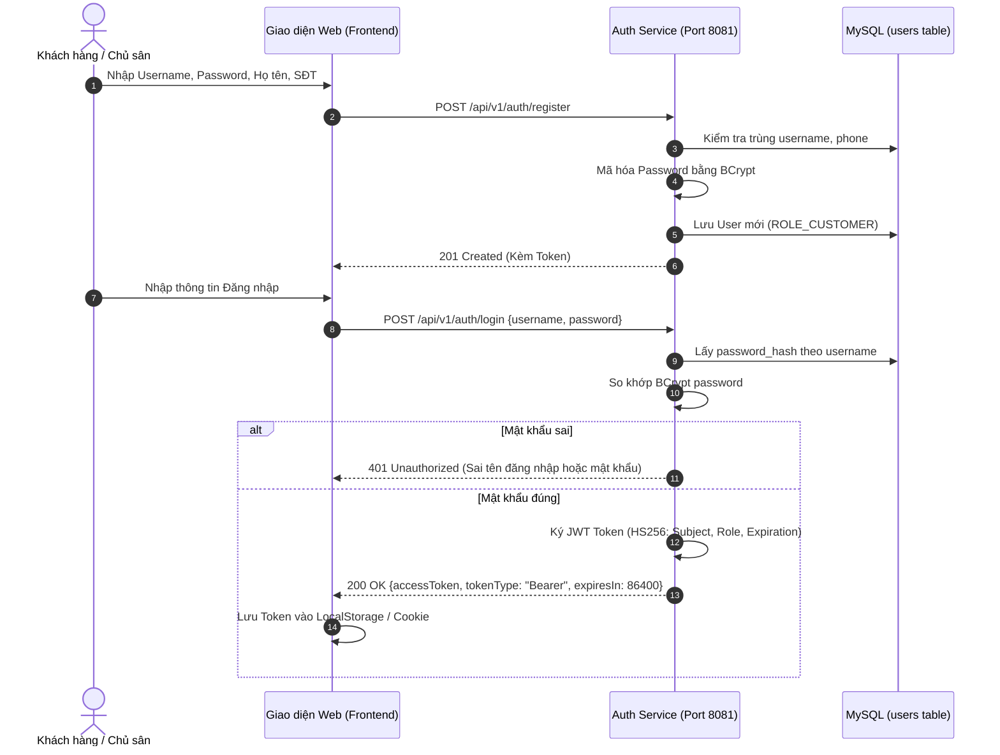
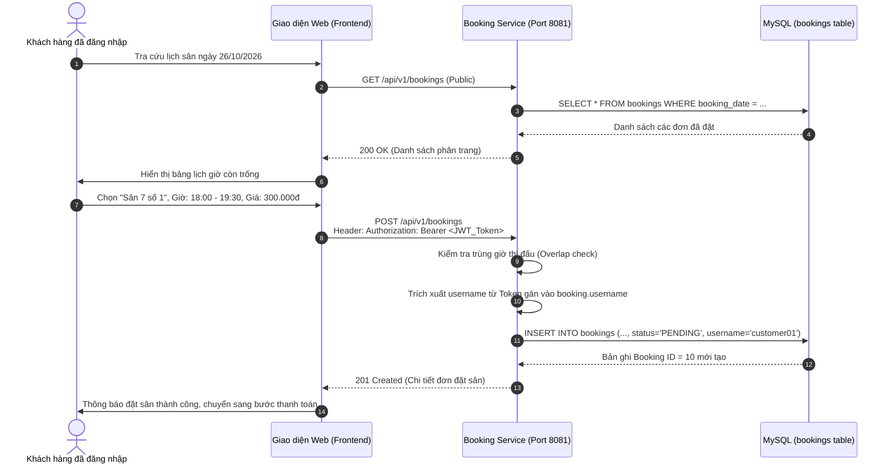
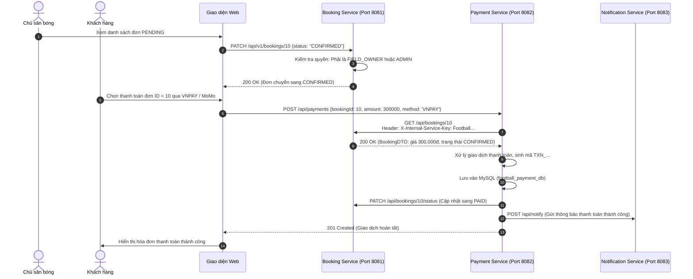
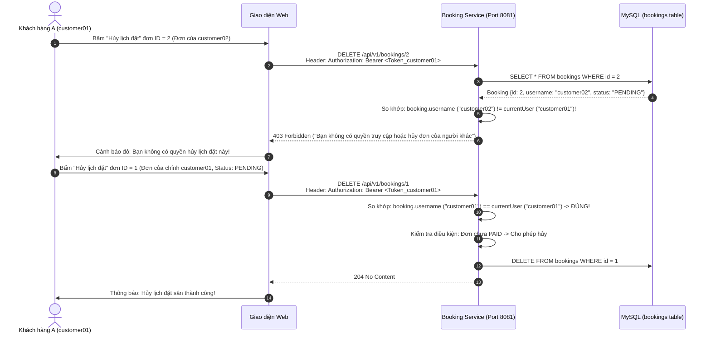

# ĐẶC TẢ NGHIỆP VỤ HỆ THỐNG QUẢN LÝ CHO THUÊ SÂN BÓNG ĐÁ
## Hệ thống hướng dịch vụ (SOA / Microservices Architecture)
**Dự án:** Football Pitch Rental Management System (Web Application)  
**Tài liệu:** Đặc tả yêu cầu phần mềm và luồng nghiệp vụ chi tiết  
**Phiên bản:** 2.0  

---

# I. TỔNG QUAN HỆ THỐNG

### 1. Bối cảnh bài toán
Tại các đô thị lớn, nhu cầu rèn luyện thể thao, đặc biệt là bóng đá phong trào, ngày càng tăng cao. Tuy nhiên, quy trình đặt sân bóng truyền thống bộc lộ rất nhiều hạn chế:
* **Khách thuê sân:** Phải gọi điện thoại từng chủ sân để hỏi giờ trống, dễ bị hủy lịch bất ngờ, không có bảng giá công khai, khó khăn khi tìm kiếm sân bóng gần khu vực.
* **Chủ sân bóng:** Quản lý lịch bằng sổ tay hoặc file Excel rời rạc, thường xuyên xảy ra tình trạng trùng giờ (Double Booking), khó kiểm soát tiền cọc, thất thoát doanh thu khi có nhiều nhân viên quản lý theo ca.
* **Quản trị viên:** Thiếu hệ thống quản trị tập trung, không có dữ liệu tổng thể để theo dõi hoạt động kinh doanh và phản ánh dịch vụ.

### 2. Mục tiêu hệ thống
Xây dựng nền tảng Web Application theo kiến trúc **hướng dịch vụ (SOA / Microservices)** kết nối thông suốt giữa **Người thuê sân**, **Chủ sân bóng** và **Ban quản trị**:
* Tự động hóa 100% quy trình tìm kiếm, tra cứu khung giờ trống và đặt lịch sân bóng.
* Quản lý phân quyền chặt chẽ (RBAC) và bảo vệ dữ liệu người dùng (Resource Ownership).
* Tích hợp thanh toán trực tuyến liên dịch vụ (Booking $\leftrightarrow$ Payment) an toàn, tức thì.
* Cung cấp Dashboard biểu đồ thống kê doanh thu, tỷ lệ lấp đầy sân theo thời gian thực.

---

# II. NGĂN XẾP CÔNG NGHỆ ÁP DỤNG (TECHNOLOGY STACK)

Hệ thống được thiết kế theo các tiêu chuẩn kỹ thuật hiện đại của công nghệ hướng dịch vụ và phát triển ứng dụng Web:

```
┌────────────────────────────────────────────────────────────────────────────────────────────────────────┐
│                                 KIẾN TRÚC NGĂN XẾP CÔNG NGHỆ HỆ THỐNG                                  │
├─────────────────────┬──────────────────────────────────────────────────────────────────────────────────┤
│ Tầng Kiến trúc      │ Công nghệ & Thư viện sử dụng                                                     │
├─────────────────────┼──────────────────────────────────────────────────────────────────────────────────┤
│ 1. Frontend Web     │ • HTML5, CSS3 hiện đại (CSS Grid/Flexbox, Dark/Light Mode, Glassmorphism)        │
│                     │ • JavaScript (ES6+), ReactJS / Next.js / Vue.js hoặc Vanilla JS                  │
│                     │ • Axios / Fetch API giao tiếp RESTful chuẩn xác                                  │
├─────────────────────┼──────────────────────────────────────────────────────────────────────────────────┤
│ 2. Backend Services │ • Java 17 LTS, Spring Boot 3.2.5 (Booking Service & Payment Service)             │
│ (Microservices)     │ • Node.js / ExpressJS (Notification Service)                                     │
│                     │ • RestClient (Spring Framework 6) cho giao tiếp liên dịch vụ đồng bộ HTTP        │
├─────────────────────┼──────────────────────────────────────────────────────────────────────────────────┤
│ 3. Xác thực & Bảo mật│ • Spring Security 6, JJWT (io.jsonwebtoken 0.12.5)                             │
│                     │ • Thuật toán băm mật khẩu BCrypt (cost 10)                                       │
│                     │ • Cơ chế kiểm soát quyền sở hữu tài nguyên (Resource Ownership Check)            │
│                     │ • Khóa liên dịch vụ máy-với-máy (X-Internal-Service-Key)                         │
├─────────────────────┼──────────────────────────────────────────────────────────────────────────────────┤
│ 4. Lưu trữ Dữ liệu  │ • MySQL 8.x theo kiến trúc Database-per-Service                                  │
│                     │   - football_booking_db (Port 3306) cho Booking Service                          │
│                     │   - football_payment_db (Port 3306) cho Payment Service                          │
│                     │ • Spring Data JPA & Hibernate ORM, quản lý giao dịch với @Transactional          │
├─────────────────────┼──────────────────────────────────────────────────────────────────────────────────┤
│ 5. Quản trị & DevOps│ • File cấu hình môi trường tập trung tổng thể: `.env`                            │
│                     │ • Swagger UI / OpenAPI 3: Tài liệu hóa RESTful API trực quan                     │
│                     │ • Maven Wrapper (mvnw.cmd), Postman v10 / Newman CLI                             │
└─────────────────────┴──────────────────────────────────────────────────────────────────────────────────┘
# III. KIẾN TRÚC TỔNG THỂ HỆ THỐNG (OVERALL SYSTEM ARCHITECTURE)

> [!NOTE]
> Hệ thống sở hữu tài liệu thiết kế kiến trúc chuyên sâu riêng: Xem chi tiết toàn bộ mô hình C4 (Context, Container, Component, Code), thiết kế lưu trữ phân tán, an ninh bảo mật 5 lớp và các quyết định kiến trúc tại: **[kientruc.md](file:///c:/Users/abinh/Downloads/football-booking-service/kientruc.md)**.

Hệ thống được xây dựng theo mô hình **Kiến trúc hướng dịch vụ (SOA) / Microservices phân tán**, tuân thủ nguyên tắc độc lập dịch vụ, mở rộng linh hoạt và bảo mật đa tầng:

```
┌─────────────────────────────────────────────────────────────────────────────────────────────────────────────────┐
│                                 SƠ ĐỒ KIẾN TRÚC TỔNG THỂ HỆ THỐNG (SYSTEM ARCHITECTURE)                         │
└─────────────────────────────────────────────────────────────────────────────────────────────────────────────────┘

   [ KHÁCH HÀNG / CẦU THỦ ]         [ CHỦ SÂN BÓNG ]                 [ QUẢN TRỊ VIÊN ]             [ POSTMAN CLI ]
     (Web Browser / Mobile)        (Quản lý lịch sân)               (Admin Dashboard)             (Kiểm thử tự động)
               │                           │                                │                            │
               └───────────────────────────┼────────────────────────────────┴────────────────────────────┘
                                           │
                                           ▼ HTTPS / RESTful API (JSON)
                      ┌──────────────────────────────────────────────┐
                      │    LỚP BẢO MẬT & ĐIỀU HƯỚNG (SECURITY BOUNDARY)│
                      │  • Bearer JWT Token Verification (HS256)     │
                      │  • Role-Based Access Control (RBAC) Filter   │
                      │  • Swagger UI / OpenAPI 3 Documentation      │
                      └──────────────────────┬───────────────────────┘
                                             │
         ┌───────────────────────────────────┼───────────────────────────────────┐
         │                                   │                                   │
         ▼                                   ▼                                   ▼
┌─────────────────────────────────┐ ┌─────────────────────────────────┐ ┌─────────────────────────────────┐
│       BOOKING SERVICE           │ │        PAYMENT SERVICE          │ │      NOTIFICATION SERVICE       │
│  (Spring Boot 3.2.5 @ Port 8081)│ │  (Spring Boot 3.2.5 @ Port 8082)│ │     (Node.js @ Port 8083)       │
│                                 │ │                                 │ │                                 │
│ • Quản lý Lịch đặt sân (CRUD)   │ │ • Xử lý thanh toán VNPAY/MoMo   │ │ • Gửi thông báo đặt sân mới     │
│ • Xác thực JWT & Băm BCrypt     │ │ • Giao dịch chuyển khoản VietQR │ │ • Cảnh báo duyệt/hủy lịch sân   │
│ • Kiểm tra Resource Ownership   │ │ • Xác nhận thanh toán tiền mặt  │ │ • Email / Webhook Alert         │
│ • Báo cáo thống kê doanh thu    │ │ • Khóa nội bộ X-Internal-Key    │ │                                 │
└────────────────┬────────────────┘ └────────┬───────────────┬────────┘ └────────────────┬────────────────┘
                 │                           │               │                           │
                 │              HTTP / REST  │               │ HTTP POST /api/notify     │
                 │   ◄───────────────────────┘               └──────────────────────────►│
                 │   (RestClient: Timeout 2s/3s)
                 │
                 ▼ JPA / Hibernate ORM                       ▼ JPA / Hibernate ORM
┌─────────────────────────────────┐                 ┌─────────────────────────────────┐
│       football_booking_db       │                 │       football_payment_db       │
│     (MySQL 8.x @ Port 3306)     │                 │     (MySQL 8.x @ Port 3306)     │
│                                 │                 │                                 │
│ • Bảng `users` (Tài khoản)      │                 │ • Bảng `payments` (Giao dịch)   │
│ • Bảng `bookings` (Lịch đặt)    │                 │   (Logical ID: `booking_id`)    │
└─────────────────────────────────┘                 └─────────────────────────────────┘
                 ▲                                                   ▲
                 └───────────────────┬───────────────────────────────┘
                                     │
                  ┌──────────────────┴──────────────────┐
                  │    FILE CẤU HÌNH TỔNG: `.env`       │
                  │  (Ports, MySQL, Secrets, Timeouts)  │
                  └─────────────────────────────────────┘
```

---

### 1. Mô tả chi tiết các phân tầng kiến trúc (Architectural Tiers)

1. **Tầng Ứng dụng khách (Client Tier):**
   * Người dùng tương tác qua giao diện Web Responsive (trên máy tính hoặc điện thoại) hoặc qua công cụ kiểm thử Postman.
   * Giao tiếp với toàn bộ backend thông qua giao thức chuẩn **HTTP/REST** với định dạng dữ liệu duy nhất là **JSON**.
2. **Tầng Dịch vụ nghiệp vụ (Microservices Tier):**
   * **Booking Service (Port 8081 - Service Provider):** Đóng vai trò là dịch vụ lõi quản lý thông tin đặt sân, xác thực người dùng, cấp phát JWT và kiểm soát quyền sở hữu dữ liệu.
   * **Payment Service (Port 8082 - Service Consumer):** Quản lý quy trình giao dịch thanh toán. Khi nhận lệnh thanh toán, service này dùng `RestClient` gọi ngược sang Booking Service để kiểm tra dữ liệu trước khi hoàn tất giao dịch.
   * **Notification Service (Port 8083 - Event Consumer):** Dịch vụ Node.js tiếp nhận các sự kiện thông báo (đặt sân thành công, duyệt đơn, hủy đơn) để gửi tới người dùng.
3. **Tầng Dữ liệu bền vững (Persistence Tier - Database-per-Service):**
   * Mỗi microservice sở hữu một cơ sở dữ liệu vật lý riêng biệt trên MySQL 8.x (`football_booking_db` và `football_payment_db`).
   * **Tuyệt đối không truy cập chéo CSDL:** Payment Service không bao giờ được nối trực tiếp vào `football_booking_db`. Việc liên kết chỉ thực hiện thông qua **Logical ID** (`booking_id`) và RESTful API.
4. **Tầng Cấu hình tập trung (Configuration Infrastructure):**
   * Toàn bộ cấu hình hệ thống (Port dịch vụ, CSDL user/pass, JWT Secret Key, thời gian Timeout) được lưu trữ tập trung tại file duy nhất **[.env](file:///c:/Users/abinh/Downloads/football-booking-service/.env)** ở thư mục gốc.

---

### 2. Sơ đồ Luồng Tương tác Dữ liệu Đa Dịch vụ (End-to-End Interaction Flow)

```mermaid
graph TD
    Client[Client / Người dùng Web] -->|1. POST /api/v1/auth/login| BookingService[Booking Service :8081]
    BookingService -->|Cấp JWT Token| Client
    
    Client -->|2. POST /api/v1/bookings + JWT| BookingService
    BookingService -->|Lưu đơn PENDING| DB_Booking[(football_booking_db)]
    
    Owner[Chủ sân bóng] -->|3. PATCH /api/v1/bookings/{id} CONFIRMED| BookingService
    
    Client -->|4. POST /api/payments| PaymentService[Payment Service :8082]
    PaymentService -->|5. GET /api/bookings/{id} + X-Internal-Service-Key| BookingService
    BookingService -->|6. Trả về BookingDTO| PaymentService
    
    PaymentService -->|7. Lưu giao dịch SUCCESS| DB_Payment[(football_payment_db)]
    PaymentService -->|8. PATCH /api/bookings/{id}/status sang PAID| BookingService
    PaymentService -->|9. POST /api/notify thông báo thành công| NotifyService[Notification Service :8083]
```

---

### 3. Danh mục Dịch vụ và Thông số Kỹ thuật (Service Portfolio)

| Tên Dịch vụ | Cổng (Port) | Công nghệ | CSDL sở hữu | Trách nhiệm chính | Giao tiếp đầu vào / đầu ra |
| :--- | :---: | :--- | :--- | :--- | :--- |
| **Booking Service** | `8081` | Spring Boot 3.2.5 (Java 17) | `football_booking_db` | • Xác thực JWT, BCrypt<br>• Quản lý lịch sân<br>• Phân quyền RBAC & Ownership<br>• Báo cáo doanh thu | **Inbound:** REST từ Client, REST nội bộ từ Payment.<br>**Outbound:** MySQL. |
| **Payment Service** | `8082` | Spring Boot 3.2.5 (Java 17) | `football_payment_db` | • Tiếp nhận thanh toán<br>• Quản lý giao dịch<br>• Gọi Booking kiểm tra ID | **Inbound:** REST từ Client.<br>**Outbound:** HTTP sang Booking (8081), Node.js (8083), MySQL. |
| **Notification Service** | `8083` | Node.js / Express | Không dùng DB | • Tiếp nhận webhook thông báo<br>• Gửi email / SMS cảnh báo | **Inbound:** HTTP POST từ Payment / Booking Service. |

---

# IV. PHÂN TÍCH 3 VAI TRÒ NGƯỜI DÙNG & NGHIỆP VỤ CHI TIẾT (ACTORS & ROLES)

Hệ thống phục vụ 3 nhóm đối tượng (Actors) với các chức năng và quyền hạn được phân định minh bạch:

```
                                  ┌───────────────────────────┐
                                  │   HỆ THỐNG SÂN BÓNG ĐÁ    │
                                  └─────────────┬─────────────┘
                                                │
         ┌──────────────────────────────────────┼──────────────────────────────────────┐
         ▼                                      ▼                                      ▼
┌──────────────────┐                  ┌──────────────────┐                  ┌──────────────────┐
│  ROLE_CUSTOMER   │                  │ ROLE_FIELD_OWNER │                  │    ROLE_ADMIN    │
│  (Người thuê sân)│                  │  (Chủ sân bóng)  │                  │  (Quản trị viên) │
└──────────────────┘                  └──────────────────┘                  └──────────────────┘
  • Đăng ký/Đăng nhập                   • Quản lý danh mục sân                • Quản lý tài khoản
  • Tra cứu sân & giờ trống             • Duyệt đơn đặt (CONFIRMED)           • Khóa/Mở tài khoản
  • Đặt sân (Tạo đơn)                   • Xem bảng lịch sân trực quan         • Giám sát toàn hệ thống
  • Xem/Hủy đơn CỦA MÌNH                • Xác nhận thanh toán tiền mặt        • Hủy đơn bất khả kháng
  • Thanh toán tiền cọc/toàn phần       • Báo cáo thống kê doanh thu          • Báo cáo tổng thể toàn sàn
```

---

## 1. NGHIỆP VỤ CỦA NGƯỜI THUÊ SÂN (`ROLE_CUSTOMER`)

Người thuê sân là các cá nhân, đội bóng phong trào có nhu cầu tìm kiếm và đặt lịch thuê sân thi đấu.

### 1.1. Đăng ký & Đăng nhập tài khoản
* Khách hàng tự đăng ký tài khoản trực tuyến qua form: Tên đăng nhập (`username`), Mật khẩu, Họ tên, Số điện thoại (bắt buộc đúng 10 số).
* Mật khẩu được mã hóa an toàn bằng thuật toán **BCrypt** trước khi lưu vào CSDL.
* Đăng nhập thành công sẽ nhận được một chuỗi **JWT Access Token** (thời hạn 24 giờ) dùng để gửi kèm trong Header `Authorization: Bearer <token>` ở mọi thao tác nghiệp vụ sau đó.

### 1.2. Tra cứu & Xem thông tin sân bóng (Chức năng công khai - Public)
* Không cần đăng nhập vẫn có thể truy cập để tìm kiếm sân.
* Xem danh sách các sân bóng đang hoạt động (Sân 5 người, Sân 7 người, Sân 11 người VIP).
* Lọc sân theo: Tên sân, loại sân, khoảng giá thuê (VNĐ/giờ), trạng thái sân.
* Xem lịch thi đấu công khai: Tra cứu khung giờ nào trong ngày đã có đội đặt, khung giờ nào đang trống để chủ động lên lịch thi đấu.

### 1.3. Đặt lịch sân bóng trực tuyến (Tạo Booking)
* Chọn sân bóng, ngày thi đấu, khung giờ bắt đầu (`start_time`) và giờ kết thúc (`end_time`).
* **Hệ thống tự động kiểm tra xung đột lịch (Conflict Check):** Nếu khung giờ đó đã có người đặt và ở trạng thái `CONFIRMED` hoặc `PAID`, hệ thống sẽ từ chối và yêu cầu chọn giờ khác.
* Khi đặt thành công:
  * Đơn đặt được tạo ở trạng thái ban đầu là **`PENDING`** (Chờ duyệt / Chờ thanh toán).
  * Hệ thống tự động trích xuất `username` từ JWT Token của khách hàng để gán vào đơn, xác lập **quyền sở hữu tài nguyên**.

### 1.4. Quản lý lịch sử đặt sân của chính mình (Resource Ownership)
* Khách hàng xem danh sách tất cả các đơn đặt sân do chính mình tạo ra.
* Xem chi tiết từng đơn đặt sân: Thông tin sân, giờ đá, số tiền, trạng thái (`PENDING`, `CONFIRMED`, `PAID`, `CANCELLED`).
* **Quy tắc bảo mật nghiêm ngặt:** Khách hàng **CHỈ ĐƯỢC XEM** đơn của mình. Nếu cố tình sửa ID trên URL để xem trộm đơn của khách hàng khác $\rightarrow$ Hệ thống lập tức trả về mã lỗi **`403 Forbidden`**.

### 1.5. Hủy lịch đặt sân (Cancellation)
* Khách hàng có thể hủy lịch đặt sân khi thay đổi kế hoạch.
* **Quy tắc nghiệp vụ & Bảo mật:**
  * Chỉ được hủy đơn do chính mình sở hữu (ngăn chặn hành vi đối thủ hủy trộm lịch).
  * **Chỉ được hủy khi đơn ở trạng thái `PENDING` hoặc `CONFIRMED`:** Nếu đơn đã thanh toán thành công (**`PAID`**), hệ thống từ chối hủy tự động với mã **`400 Bad Request`** và hướng dẫn khách liên hệ hotline của chủ sân để làm thủ tục hoàn tiền.

### 1.6. Thanh toán tiền sân trực tuyến (Payment Integration)
* Khách hàng có thể thanh toán tiền đặt cọc (ví dụ 100.000 VNĐ) hoặc thanh toán toàn phần tiền sân.
* Lựa chọn phương thức thanh toán linh hoạt:
  * Ví điện tử: **VNPAY**, **MOMO**.
  * Chuyển khoản ngân hàng: **BANKING** (Quét mã VietQR tiện lợi).
  * Thanh toán trực tiếp tại quầy: **CASH**.
* Khi thanh toán thành công qua `Payment Service`:
  * Mã giao dịch duy nhất được sinh ra: `TXN_1728300000001`.
  * Trạng thái đơn đặt sân được chuyển sang **`PAID`**.
  * `Notification Service` ghi nhận gửi thông báo xác nhận thanh toán.

---

## 2. NGHIỆP VỤ CỦA CHỦ SÂN BÓNG (`ROLE_FIELD_OWNER`)

Chủ sân bóng là cá nhân hoặc đơn vị kinh doanh sở hữu và vận hành cơ sở cụm sân bóng đá.

### 2.1. Quản lý danh mục cơ sở & Sân bóng
* Thiết lập danh sách các sân con trong cụm sân:
  * Tên sân (VD: *Sân 7 người số 1*, *Sân 11 người VIP*, *Sân 5 mini*).
  * Loại sân: 5 người, 7 người, 11 người.
  * Bảng giá thuê sân: Giá ngày thường vs Giá khung giờ vàng buổi tối (17h30 - 22h00).
  * Thiết lập trạng thái sân: Hoạt động hoặc Tạm dừng bảo trì cỏ/đèn chiếu sáng.

### 2.2. Tiếp nhận & Duyệt đơn đặt sân (Booking Approval)
* Nhận thông báo khi có khách hàng vừa đặt lịch mới trên hệ thống.
* Kiểm tra lịch thi đấu, xác nhận khách hợp lệ: Chủ sân thực hiện thao tác duyệt đơn, chuyển trạng thái từ **`PENDING`** sang **`CONFIRMED`**.
* Khách hàng thông thường (`ROLE_CUSTOMER`) không có quyền tự duyệt đơn (nếu cố tình gửi request PATCH duyệt $\rightarrow$ bị hệ thống chặn với mã `403 Forbidden`).

### 2.3. Bảng điều khiển lịch sân trực quan (Pitch Timeline Board)
* Giao diện lịch biểu theo ngày và tuần thể hiện các slot giờ của từng sân:
  * Màu vàng: Đơn `PENDING` chờ xử lý.
  * Màu xanh dương: Đơn `CONFIRMED` đã duyệt giữ chỗ.
  * Màu xanh lá: Đơn `PAID` đã thanh toán đầy đủ.
  * Màu xám: Khung giờ trống sẵn sàng đón khách.
* Chủ sân có thể tạo đơn đặt sân thủ công cho khách vãng lai gọi điện thoại trực tiếp hoặc đến sân trực tiếp.

### 2.4. Xác nhận thanh toán tại quầy
* Khi khách hàng đá bóng xong và trả tiền mặt tại sân, chủ sân thao tác cập nhật đơn sang `PAID` để hoàn tất hợp đồng thuê sân và lưu vào doanh thu.

### 2.5. Báo cáo & Thống kê doanh thu cơ sở (`GET /api/v1/bookings/statistics`)
* Chủ sân xem báo cáo hiệu quả kinh doanh của sân:
  * Tổng số lượt đặt sân trong ngày/tuần/tháng.
  * Số lượng đơn phân theo từng trạng thái: Bao nhiêu đơn PENDING, CONFIRMED, PAID, CANCELLED.
  * **Tổng doanh thu thực tế thu được (Tổng tiền từ các đơn `PAID`).**
  * Tỷ lệ lấp đầy sân vào các khung giờ cao điểm để đưa ra chiến lược khuyến mãi giờ thấp điểm.

---

## 3. NGHIỆP VỤ CỦA QUẢN TRỊ VIÊN HỆ THỐNG (`ROLE_ADMIN`)

Quản trị viên là người điều hành cao nhất, chịu trách nhiệm vận hành nền tảng Web cho thuê sân bóng đá.

### 3.1. Quản lý tài khoản người dùng toàn hệ thống
* Xem danh sách toàn bộ tài khoản trong bảng `users` (`Khách hàng`, `Chủ sân`, `Admin`).
* Kích hoạt hoặc khóa tạm thời các tài khoản vi phạm (ví dụ: khách đặt sân ảo liên tục rồi hủy, chủ sân gian lận thông tin).
* Phân quyền tài khoản: Nâng cấp tài khoản khách hàng lên làm Chủ sân (`ROLE_FIELD_OWNER`).

### 3.2. Giám sát toàn diện các giao dịch & Lịch đặt sân
* Có quyền tra cứu và xem chi tiết **MỌI ĐƠN ĐẶT SÂN** của bất kỳ khách hàng nào và bất kỳ chủ sân nào.
* Không bị giới hạn bởi quy tắc Resource Ownership (Superuser privilege).

### 3.3. Can thiệp giải quyết tranh chấp & Hủy đơn bất khả kháng
* Can thiệp xử lý khi có khiếu nại giữa khách hàng và chủ sân (VD: khách đã chuyển khoản nhưng chủ sân chưa duyệt đơn).
* Admin có thẩm quyền hủy đơn đặt sân bất kỳ (`DELETE /api/v1/bookings/{id}`) khi xảy ra các tình huống bất khả kháng:
  * Thời tiết mưa bão ngập lụt không thể thi đấu.
  * Cúp điện toàn khu vực hoặc sự cố kỹ thuật hỏng dàn đèn chiếu sáng.
  * Hủy đơn vi phạm quy định sàn thương mại điện tử.

### 3.4. Báo cáo thống kê toàn sàn (System-wide Analytics)
* Xem tổng doanh thu của toàn bộ các cơ sở sân bóng trên hệ thống.
* Thống kê lượng người dùng mới đăng ký hàng tháng.
* Thống kê tần suất hoạt động của các dịch vụ backend, cảnh báo lỗi liên dịch vụ khi có sự cố.

---

# V. QUY TRÌNH NGHIỆP VỤ CỐT LÕI (CORE BUSINESS WORKFLOWS)

---

### QUY TRÌNH 1: Đăng ký, Đăng nhập & Xác thực JWT Token



---

### QUY TRÌNH 2: Tra cứu & Đặt sân bóng đá trực tuyến



---

### QUY TRÌNH 3: Duyệt đơn & Thanh toán trực tuyến liên dịch vụ (Payment)



---

### QUY TRÌNH 4: Hủy đơn đặt sân & Kiểm tra quyền sở hữu (Ownership Check)



---

# VI. ĐẶC TẢ GIAO DIỆN WEB CẦN CÓ (WEB UI/UX SPECIFICATIONS)

Hệ thống Web được thiết kế với 3 phân hệ giao diện trực quan:

### 1. Phân hệ Khách hàng (Customer Portal)
* **Trang chủ (Landing Page):** Giới thiệu cụm sân bóng đá, hình ảnh sân cỏ nhân tạo, hệ thống đèn LED, tiện ích (nước uống, thuê giày, gửi xe, phòng thay đồ).
* **Trang Tra cứu & Đặt sân (Field Booking Page):**
  * Bộ lọc thông minh: Chọn ngày thi đấu (Date Picker), chọn loại sân (5, 7, 11), chọn khung giờ mong muốn.
  * Lưới khung giờ (Slot Grid): Hiển thị trực quan các ô giờ `Trống (Xanh)` và `Đã đặt (Đỏ)`.
  * Modal xác nhận đặt sân: Hiển thị tiền cọc, quy định hủy sân, nhập thông tin liên hệ.
* **Trang Lịch sử đặt sân (My Bookings):**
  * Bảng danh sách các đơn đã đặt với các Tag trạng thái màu sắc: `Chờ duyệt`, `Đã duyệt`, `Đã thanh toán`, `Đã hủy`.
  * Nút hành động: "Thanh toán ngay" (đối với đơn Confirmed), "Hủy đặt sân" (đối với đơn chưa đá).
* **Trang Thanh toán (Checkout Page):**
  * Hiển thị mã QR ngân hàng VietQR tự động điền số tiền và mã đơn.
  * Nút chọn cổng VNPAY / MoMo.

### 2. Phân hệ Chủ sân (Owner Management Portal)
* **Bảng điều khiển (Dashboard):**
  * 4 thẻ số liệu thống kê nhanh: Doanh thu hôm nay, Số đơn chờ duyệt, Số trận đấu trong ngày, Tỷ lệ lấp đầy sân (%).
  * Danh sách đơn đặt sân mới nhất cần duyệt ngay lập tức.
* **Quản lý Lịch thi đấu trực quan (Scheduler Calendar):**
  * Giao diện dạng Timeline kéo dài từ 06:00 đến 23:00 mỗi ngày.
  * Thao tác 1 click để duyệt đơn từ `PENDING` sang `CONFIRMED`.
  * Thao tác tạo nhanh đơn đặt cho khách đặt tại quầy.
* **Báo cáo doanh thu (Revenue Analytics):**
  * Biểu đồ doanh thu theo tuần/tháng/năm.
  * Bảng tổng kết tiền cọc đã thu và tiền mặt tại quầy.

### 3. Phân hệ Quản trị viên (Admin Portal)
* **Quản trị người dùng (User Management):**
  * Danh sách tài khoản: Họ tên, Username, Số điện thoại, Vai trò (`CUSTOMER`, `FIELD_OWNER`).
  * Nút chuyển đổi trạng thái: Khóa tài khoản / Mở khóa tài khoản.
* **Giám sát giao dịch toàn sàn (Transaction Monitor):**
  * Theo dõi lịch sử thanh toán liên dịch vụ theo thời gian thực.
  * Can thiệp hủy đơn khi có sự cố kỹ thuật khẩn cấp.
* **Tài liệu API tích hợp sẵn (Swagger UI):**
  * Đường dẫn `/swagger-ui/index.html` có sẵn nút **Authorize** dán Bearer Token để lập trình viên và quản trị viên kiểm thử API trực tiếp trên trình duyệt.

---

# VII. YÊU CẦU PHI CHỨC NĂNG (NON-FUNCTIONAL REQUIREMENTS)

1. **Hiệu năng & Tốc độ đáp ứng (Performance):**
   * Thời gian phản hồi API tra cứu danh sách sân $< 300\text{ ms}$.
   * Toàn bộ API truy vấn danh sách đều hỗ trợ phân trang (`page`, `size`) và sắp xếp (`sort`) để tránh tràn bộ nhớ máy chủ.
   * Cấu hình Connection Pool HikariCP tối ưu kết nối tới MySQL.
2. **An toàn thông tin (Security):**
   * Tuyệt đối không lưu mật khẩu dạng rõ (Plaintext) $\rightarrow$ 100% băm bằng BCrypt với Salt ngẫu nhiên.
   * Ngăn chặn hoàn toàn lỗ hổng **BOLA/IDOR** bằng cơ chế kiểm tra quyền sở hữu tại Service Layer.
   * Ngăn chặn tấn công Brute-force: Thông báo lỗi đăng nhập chung: *"Tên đăng nhập hoặc mật khẩu không chính xác"*, không tiết lộ username có tồn tại hay không.
3. **Tính chịu lỗi trong môi trường phân tán (Fault Tolerance):**
   * Cài đặt Timeout rõ ràng khi gọi liên dịch vụ: `connectTimeout = 2000ms`, `readTimeout = 3000ms`.
   * Khi một dịch vụ gặp sự cố (Down), dịch vụ còn lại bắt ngoại lệ và trả về mã HTTP `503 Service Unavailable` kèm thông báo thân thiện, không làm sập toàn bộ hệ thống.
4. **Khả năng bảo trì & Mở rộng (Maintainability & Scalability):**
   * Tuân thủ kiến trúc **Database-per-Service**: Mỗi microservice sở hữu CSDL riêng biệt, dễ dàng tách thành các container Docker độc lập trong tương lai.
   * Toàn bộ cấu hình (Port, DB user/pass, Secret key, Timeout) được quản lý tập trung tại file duy nhất [.env](file:///c:/Users/abinh/Downloads/football-booking-service/.env).
