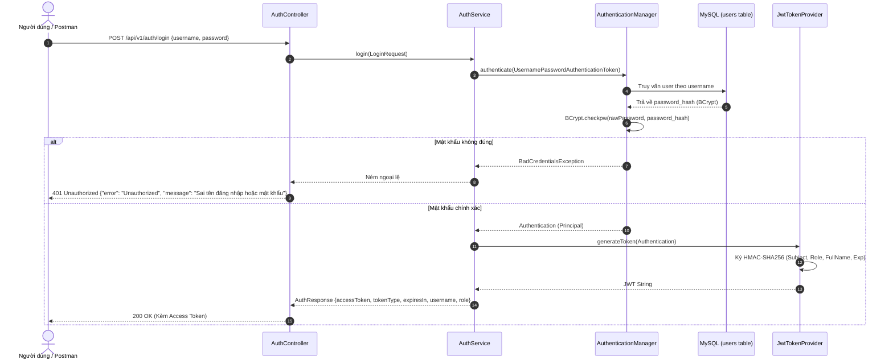
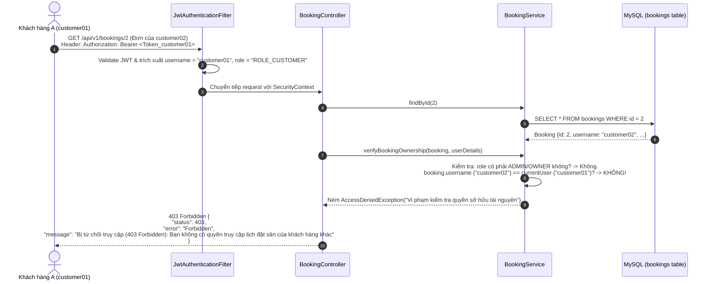
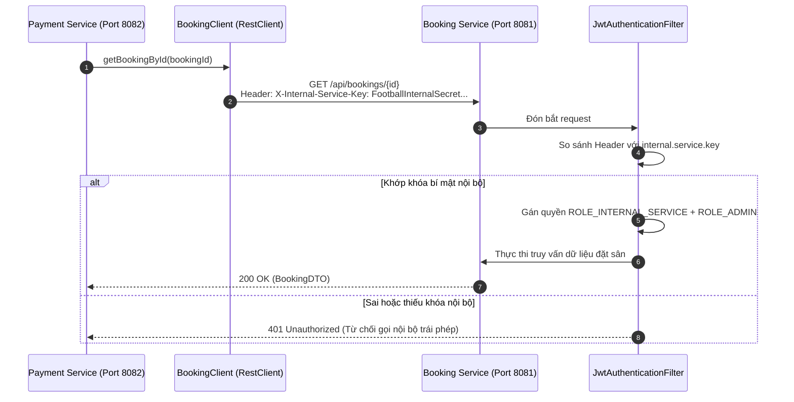

# KIẾN TRÚC VÀ THIẾT KẾ BẢO MẬT REST API (API SECURITY DESIGN)
**Hệ thống:** Quản lý đặt lịch sân bóng đá (Football Booking System)  
**Công nghệ:** Spring Boot 3.2.5, Spring Security 6, JJWT 0.12.5, BCrypt, MySQL  

---

## 1. Tổng quan kiến trúc bảo mật (Security Architecture)

Hệ thống áp dụng mô hình **Stateless JWT Authentication & Role-Based Authorization** kết hợp với **Resource Ownership Verification** tại Service Layer.

```
+-----------------------------------------------------------------------------------+
|                                  CLIENT (POSTMAN)                                 |
+-----------------------------------------------------------------------------------+
            |                                           |
    1. POST /auth/login                         2. Request có Header
    (username, password)                        Authorization: Bearer <JWT>
            |                                           |
            v                                           v
+-----------------------+                   +---------------------------------------+
|     Auth Service      |                   |       Spring Security Filter Chain    |
| (Authentication Mgr)  |                   +---------------------------------------+
+-----------------------+                                       |
            |                                                   v
    - So khớp BCrypt Hash                       +-----------------------------------+
    - Cấp JWT có thời hạn                       |      JwtAuthenticationFilter      |
            |                                   | - Giải mã & kiểm tra chữ ký HS256 |
            v                                   | - Nạp UserDetails vào Context     |
    Response Access Token                       +-----------------------------------+
    {"accessToken": "...",                                      |
     "expiresIn": 86400}                                        v
                                                +-----------------------------------+
                                                |     URL Matching & RBAC Check     |
                                                |  (permitAll vs authenticated)     |
                                                +-----------------------------------+
                                                                |
                                                                v
                                                +-----------------------------------+
                                                |        Controller Layer           |
                                                |   (@AuthenticationPrincipal)      |
                                                +-----------------------------------+
                                                                |
                                                                v
                                                +-----------------------------------+
                                                |   Resource Ownership Validation   |
                                                | (booking.username == currentUser) |
                                                +-----------------------------------+
                                                                |
                                                +---------------+---------------+
                                                |                               |
                                           [Thỏa mãn]                    [Vi phạm]
                                                |                               |
                                                v                               v
                                          Xử lý DB MySQL                403 FORBIDDEN
```

---

## 2. Luồng xác thực đăng nhập (Login & Token Generation Flow)



---

## 3. Luồng kiểm tra quyền sở hữu tài nguyên (Resource Ownership Check)



---

## 4. Bảo mật giao tiếp giữa các dịch vụ (Inter-Service Security)

Trong kiến trúc Microservices, dịch vụ `payment-service` cần gọi sang `booking-service` để kiểm tra sự tồn tại của lịch đặt sân trước khi cho phép thanh toán.

### 4.1. Giải pháp Machine-to-Machine: Service Credential Key
- **Header xác thực:** `X-Internal-Service-Key`
- **Khóa bí mật:** `FootballInternalSecretServiceKey2026` (được cấu hình đồng bộ qua biến môi trường `INTERNAL_SERVICE_KEY` trong file `.env` tổng).
- **Cơ chế hoạt động:**
  1. `payment-service` cấu hình `BookingClient` tự động thêm Header `X-Internal-Service-Key` vào mỗi REST request gửi sang `booking-service`.
  2. Tại `booking-service`, bộ lọc `JwtAuthenticationFilter` kiểm tra nếu Header `X-Internal-Service-Key` khớp với cấu hình hệ thống, hệ thống lập tức cấp quyền nội bộ `ROLE_INTERNAL_SERVICE` và `ROLE_ADMIN` trong `SecurityContext`.
  3. Yêu cầu nội bộ được thực thi an toàn mà không cần truyền mật khẩu người dùng hoặc giả mạo token.



---

## 5. Chuẩn hóa cấu trúc phản hồi lỗi (Standard Error Format)

Tất cả các lỗi xác thực (401), từ chối truy cập (403), lỗi nghiệp vụ (400), và không tìm thấy (404) đều được định dạng JSON đồng nhất:

```json
{
  "timestamp": "2026-10-26T10:30:00.123456",
  "status": 403,
  "error": "Forbidden",
  "message": "Bị từ chối truy cập (403 Forbidden): Bạn không có quyền truy cập lịch đặt sân của khách hàng khác (Vi phạm kiểm tra quyền sở hữu tài nguyên)",
  "path": "/api/v1/bookings/2"
}
```
